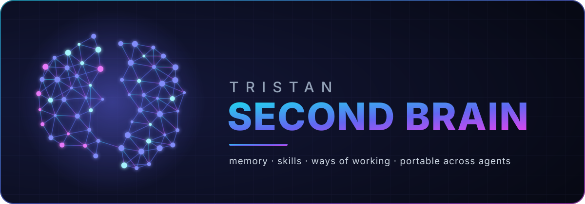

  

# second-brain template

A template for backing up and restoring your AI-agent setup (skills, memory, settings), and for bootstrapping other agents from it.

## What is here

| Path | Purpose |
|---|---|
| `RESTORE-OTHER-AGENTS.md` | Where each agent (Codex, Gemini CLI, Cursor, ...) reads global and per-repo instructions |
| `scripts/build-portable-context.py` | Flattens a `claude/memory/` folder into one agent-agnostic markdown file |
| `scripts/make-logo.py` | Generates the logo |
| `examples/settings.example.json` | Claude Code settings showing permission and hook patterns, with placeholders |
| `claude/skills/kb` | Example skill: write a KB article after a debugging session |

## Use it

1. Fork or copy this repo into a **private** repo of your own.
2. Copy your own `~/.claude/` skills, memory and settings into `claude/`.
3. Run `python3 scripts/build-portable-context.py` to produce a portable context file.
4. Follow `RESTORE-OTHER-AGENTS.md` for the agent you want to restore into.

Keep real memory, emails, paths, account IDs and secrets out of any public copy.

## License

MIT, see `LICENSE`.
